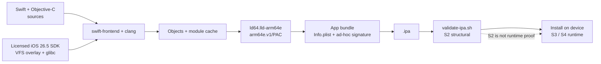

<p align="center">
  <strong>Build native iOS <code>.ipa</code> files inside iSH — no Mac in the loop.</strong>
</p>

<h1 align="center">iOS Swift Builder</h1>

<p align="center">
  A reproducible, script-driven toolkit for compiling, linking, signing and validating
  arm64e/PAC iOS apps on iSH or Linux, using inputs you are licensed to use.
</p>

<p align="center">
  <a href="https://github.com/luiz-izidoro/forge-on-glass/actions/workflows/static.yml"></a>
  
  
  
  
  
</p>

> [!WARNING]
> This repository contains **only original scripts, documentation and sample sources**. It does
> **not** distribute the Apple iOS SDK, Swift toolchain, glibc, PAC linker, compiled modules, IPAs,
> signing certificates or provisioning profiles. You must obtain and license those inputs yourself.

> Unofficial project. Not affiliated with, endorsed by, or sponsored by Apple Inc. Apple, Xcode,
> iOS and Swift are trademarks of their respective owners.

---

## Table of contents

- [What this is](#what-this-is)
- [What works / what does not](#what-works--what-does-not)
- [Build pipeline](#build-pipeline)
- [Quick start](#quick-start)
- [Supported workflows](#supported-workflows)
- [From zero](#from-zero)
- [Configuration](#configuration)
- [Validation ladder](#validation-ladder)
- [Repository map](#repository-map)
- [Troubleshooting](#troubleshooting)
- [Licensing and publication boundary](#licensing-and-publication-boundary)
- [Documentation map](#documentation-map)
- [Contributing](#contributing)
- [License](#license)

## What this is

A small, auditable build system for producing an iOS app bundle and IPA without a Mac:

- **Compile** Swift and Objective-C sources against a user-supplied iOS 26.5 SDK.
- **Link** a thin `arm64e` Mach-O with the canonical `arm64e.v1/PAC` subtype.
- **Sign** ad-hoc for debug/StikDebug, or leave unsigned for a LiveContainer/SideStore handoff.
- **Validate** the IPA structure, `LC_MAIN`, chained fixups, signature and bundle layout.
- **Port** an existing third-party project into the workflow with `scripts/port-third-party.py`.
- **Stay legal**: fetch or derive Apple/toolchain material on your own licensed machine; never
  commit it here.

It is intentionally **not** a replacement for Xcode, a signing service, or an App Store pipeline.

## What works / what does not

| Works | Does not |
|---|---|
| Pure SwiftUI and UIKit apps for `arm64e-apple-ios26.5` | Redistribute Apple SDKs, headers, `.tbd`, `.swiftinterface` or `.swiftmodule` files |
| Foundation/Dispatch-only apps | Build the discontinued arm64 (non-PAC) profile |
| Objective-C/UIKit shells bridged into Swift | Provide signing certificates, provisioning profiles or App Store upload |
| Weak-linked frameworks such as FoundationModels (`--weak-framework`) | Guarantee device runtime behavior from static validation alone |
| Ad-hoc signing and unsigned LiveContainer handoffs | Replace Xcode or macOS for general iOS development |
| One-time arm64e module-cache generation on a real Linux VM | Build a full UIKit/SwiftUI cache on iSH without a prepared cache |

## Build pipeline



The only supported profile is **arm64e/PAC**. The linker receives the `UIKitCore` generic stub and
a client name; the resulting app is structurally valid but still needs a device run for functional
acceptance.

## Quick start

### Prerequisites

- **iSH** on iOS (Alpine), or a **Linux VM/container** for the one-time module-cache build.
- A legally obtained **iOS 26.5 SDK**, **Swift 6.3.3** toolchain, **glibc loader** and
  **arm64e/PAC linker**.
- `clang`, `ldid`, `llvm-strip`, `zip` and `python3` available in the build environment.
- At least ~2 GB free disk for the SDK/toolchain and module cache.

These inputs are not distributed here. The exact staging steps are in
[`REPRODUCE-FROM-ZERO.md`](REPRODUCE-FROM-ZERO.md) and
[`references/BOOTSTRAP.md`](references/BOOTSTRAP.md).

### 1. Clone and inspect

```sh
git clone https://github.com/luiz-izidoro/forge-on-glass.git
cd ios-swift-builder
sh bootstrap.sh --check
```

A fresh clone intentionally exits nonzero and prints each missing input. That is the staging
checklist, not a repository failure.

### 2. Stage the licensed inputs

Follow [`REPRODUCE-FROM-ZERO.md`](REPRODUCE-FROM-ZERO.md). In short, provide:

```text
ISB_SYSROOT/iPhoneOS26.5.sdk
ISB_SYSROOT/vfs/overlay.yaml
ISB_SWIFT/usr/bin/swift-frontend          # Swift 6.3.3
ISB_TOOLCHAIN_ROOT/ld64.lld-arm64e       # PAC linker
ISB_FOUNDATION_BUILD/                    # arm64e module cache
glibc loader + required tools
```

The module cache is generated **once on a real Linux VM or Docker host** with
`references/linux-vm/orchestrator_vm633.py`, then copied locally. It is not silently manufactured on
iSH.

### 3. Verify

```sh
sh scripts/check-env.sh
```

It reports each missing item and ends with `arm64e: READY` when the environment is complete.

### 4. Build and validate

```sh
sh scripts/build-pure-ui.sh MyApp com.example.myapp main.swift
sh scripts/validate-ipa.sh /var/minis/workspace/MyApp.ipa
```

Use `ISB_OUTPUT` to choose a different output path. Multiple Swift files are compiled as one module
with `-primary-file`; the entry file must be `main.swift` or end in `Main.swift`.

## Supported workflows

| Goal | Command |
|---|---|
| SwiftUI / UIKit app | `sh scripts/build-pure-ui.sh MyApp com.example.myapp main.swift` |
| Foundation / Dispatch only | `sh scripts/build-pure-foundation.sh FoundationApp main.swift` |
| Swift + Objective-C/UIKit shell | `sh scripts/build-ipa.sh App com.example.app assets/AppLogic.swift assets/AppShell.m` |
| Capability-gated AI framework | `sh scripts/build-pure-ui.sh AIApp com.example.ai main.swift assets/FoundationModelsProbe.swift --weak-framework FoundationModels` |
| NaturalLanguage / NLEmbedding bridge | `sh scripts/build-pure-ui.sh EmbedApp com.example.embed main.swift assets/NativeEmbeddings.swift --extra-objc assets/NativeNLBridge.m --extra-framework NaturalLanguage` |
| Third-party project outside the checkout | `python3 scripts/port-third-party.py /tmp/project MyApp com.example.myapp` |
| Unsigned handoff | add `--unsigned` (or `ISB_UNSIGNED=1`) |
| Structural validation | `sh scripts/validate-ipa.sh <path>.ipa` |

`validate-ipa.sh` requires a thin ARM64 Mach-O with the canonical `arm64e.v1/PAC` subtype,
executable filetype, one app bundle, `LC_MAIN`, valid chained fixups and a valid code signature
unless `ISB_REQUIRE_SIGNATURE=0` is explicitly set for an unsigned guest.

## From zero

1. **SDK** — place the licensed iOS 26.5 SDK at `ISB_SYSROOT/iPhoneOS26.5.sdk` and the matching
   `vfs/overlay.yaml`.
2. **Swift** — install Swift 6.3.3 at `ISB_SWIFT` (default `/opt/swift6.3.3`).
3. **glibc + linker** — provide the glibc loader and `ld64.lld-arm64e`; the glibc step is explicit
   because it is assembled from Ubuntu aarch64 packages and is not redistributed.
4. **Module cache** — on a real Linux VM/container, run
   `python3 references/linux-vm/orchestrator_vm633.py` with your SDK; copy the resulting
   `foundation-build633-arm64e` cache to `ISB_FOUNDATION_BUILD`.
5. **Verify** — run `sh scripts/check-env.sh` until `arm64e: READY`.
6. **Build** — run one of the commands above, then validate the IPA.

The full narrative, including explicit URL/SHA-256 inputs for the Swift/SDK stages, is in
[`REPRODUCE-FROM-ZERO.md`](REPRODUCE-FROM-ZERO.md) and
[`references/BOOTSTRAP.md`](references/BOOTSTRAP.md).

## Configuration

Most paths can be overridden through environment variables. The defaults are defined in
[`scripts/profile.sh`](scripts/profile.sh) and checked by `scripts/check-env.sh`.

| Variable | Purpose |
|---|---|
| `ISB_SYSROOT` | Root containing `iPhoneOS26.5.sdk` and `vfs/overlay.yaml`. |
| `ISB_SW` (or `ISB_SW_ROOT` for `check-env.sh`) | Swift 6.3.3 toolchain root. |
| `ISB_TOOLCHAIN_ROOT` | PAC linker, extra framework stubs and module cache root. |
| `ISB_FOUNDATION_BUILD` | arm64e module cache directory. |
| `ISB_LINKER` | PAC-capable `ld64.lld` path. |
| `ISB_WORKSPACE` | Working directory for build artifacts (default `/var/minis/workspace`). |
| `ISB_OUTPUT` | Explicit IPA output path (default `$ISB_WORKSPACE/<App>.ipa`). |
| `ISB_ARCH` | Only `arm64e` is supported; other values exit with an error. |
| `ISB_OPT` | Optimization: `none`, `O` (default) or `Osize`. |
| `ISB_STRIP` | Strip symbols when set to `1`. |
| `ISB_UNSIGNED` | Produce an unsigned guest for LiveContainer/SideStore re-signing. |
| `ISB_REQUIRE_SIGNATURE` | Set to `0` only for validation of an intentionally unsigned IPA. |
| `ISB_INCREMENTAL` | Enable the opt-in content-addressed object cache. |

Example:

```sh
ISB_SYSROOT=/opt/isb/sysroot \
ISB_WORKSPACE="$PWD/out" \
ISB_OUTPUT="$PWD/out/Demo.ipa" \
sh scripts/build-pure-ui.sh Demo com.example.demo assets/PureSwiftDemo.swift
```

## Validation ladder

| Level | Meaning |
|---|---|
| **S0** | Hypothesis or unverified claim. |
| **S1** | Source compiles. |
| **S2** | A fresh, structurally valid IPA passes `validate-ipa.sh`. |
| **S3** | The IPA opens on a device. |
| **S4** | A real functional flow succeeds on the device. |

Never promote S2 to S3/S4 from static inspection. A structurally valid IPA can still fail at launch
because of entitlements, weak linking, OS version or signing.

## Repository map

```text
scripts/                 build, link, sign, validate, environment and release gates
assets/                  original sample Swift/Objective-C sources
references/              method, bootstrap, publishing, governance and troubleshooting guides
references/linux-vm/     one-time arm64e module-cache orchestrator
.github/                 CI static checks, issue templates, security policy
bootstrap.sh             shorthand for scripts/bootstrap.sh --check
Dockerfile               reproducibility aid for the Linux VM/build environment
```

## Troubleshooting

| Symptom | Likely cause | Fix |
|---|---|---|
| `bootstrap.sh --check` exits 1 | Licensed inputs are not staged yet | Read the `MISSING` list; this is expected on a fresh clone. |
| `check-env.sh` says `NOT READY` | One or more paths/tools are missing | Fix each `XX` line; it names the exact path. |
| `file: not found` | Minimal Alpine image lacks `file` | Install `file`; the current checker reports the limitation instead of crashing. |
| `module cache directory not writable` | `ISB_MODULE_CACHE`/`/var/tmp` is read-only | Point `ISB_MODULE_CACHE` to a writable directory. |
| `PAC linker is not native aarch64` | Wrong `ld64.lld` architecture | Use the arm64e/PAC linker from the documented toolchain. |
| IPA fails validation | Wrong slice, subtype, `LC_MAIN`, fixups or signature | Read the validator output; rebuild with the canonical `arm64e` profile. |
| App installs but crashes | Entitlements, weak framework, OS mismatch or signing | Reproduce on device (S3/S4); static validation cannot prove runtime behavior. |
| Build runs out of disk/memory | SDK/cache size or parallel objects | Free space, use `ISB_INCREMENTAL=1`, and build one app at a time. |

## Licensing and publication boundary

- **Safe to publish:** original scripts, documentation, sample sources and diagrams.
- **Never publish:** SDK files, headers, `.tbd`, `.swiftinterface`, `.swiftmodule`, `.pcm`,
  toolchains, glibc binaries, IPAs, signing certificates, provisioning profiles, generated patches
  with verbatim SDK context, credentials or personal paths.
- The MIT license applies only to original material. Apple/Swift/toolchain licenses remain with
  their owners. See [`NOTICE.md`](NOTICE.md) and
  [`references/PUBLISHING.md`](references/PUBLISHING.md).
- The repository ships scripts that fetch or derive third-party material on the user's machine; it
  does not mirror SDKs.

## Documentation map

| Document | Contents |
|---|---|
| [`REPRODUCE-FROM-ZERO.md`](REPRODUCE-FROM-ZERO.md) | Full clean-environment path. |
| [`references/BOOTSTRAP.md`](references/BOOTSTRAP.md) | SDK, Swift and glibc staging details. |
| [`references/PROJECT-GUIDE.md`](references/PROJECT-GUIDE.md) | Internal and external project workflows. |
| [`references/BEST-PRACTICES.md`](references/BEST-PRACTICES.md) | Build and validation practice. |
| [`references/VERSION-MATRIX.md`](references/VERSION-MATRIX.md) | Validated versions. |
| [`references/HANDOFF.md`](references/HANDOFF.md) | Maintenance handoff. |
| [`references/PROJECT-GOVERNANCE.md`](references/PROJECT-GOVERNANCE.md) | Governance and release gates. |
| [`references/PUBLISHING.md`](references/PUBLISHING.md) | Copyright and publication analysis. |
| [`SECURITY.md`](SECURITY.md) | Security policy. |
| [`CONTRIBUTING.md`](CONTRIBUTING.md) | Contribution rules. |

## Contributing

Read [`CONTRIBUTING.md`](CONTRIBUTING.md) and
[`references/PROJECT-GOVERNANCE.md`](references/PROJECT-GOVERNANCE.md) before changing build logic.
Run the release gate before opening a pull request:

```sh
sh scripts/verify-release.sh
```

## License

MIT. See [`LICENSE`](LICENSE). Third-party material is not licensed by this repository; see
[`NOTICE.md`](NOTICE.md).
